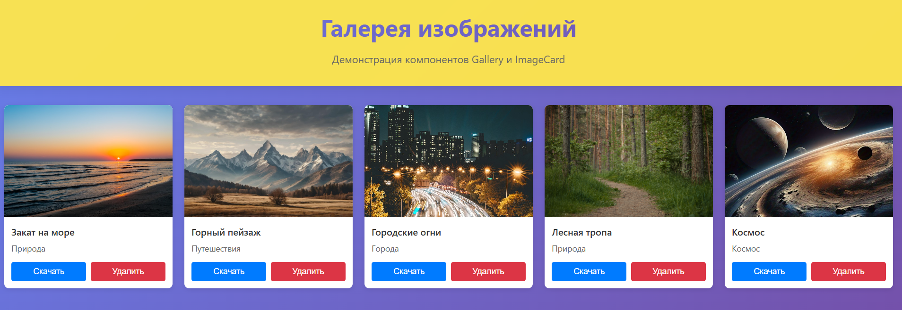

# Лабораторная работа №4: Галерея изображений

## Описание проекта
Проект состоит из двух частей:
1. **UI-библиотека (`ui-library`)** — содержит переиспользуемые компоненты `Gallery` и `ImageCard`.
2. **Демонстрационное приложение (`frontend`)** — показывает пример использования библиотеки.

**Реализованный функционал:**
- Галерея отображается в виде адаптивной плитки (CSS Grid).
- Количество колонок автоматически подстраивается под ширину экрана без горизонтального скролла.
- Длинные подписи обрезаются многоточием и показываются полностью при наведении (атрибут `title`).
- Карточка изображения содержит превью, название, альбом и кнопки действий («Скачать» и «Удалить»).
- Действия скачивания и удаления передаются в компонент `ImageCard` через `props` (`onDownload`, `onDelete`).
- Реализовано реальное скачивание файлов через браузерный API (создание временной ссылки `<a>`).

## Используемые технологии
- **React 19** + **TypeScript**
- **Vite** (сборка приложения и библиотеки в ES-модули с генерацией `.d.ts` файлов)
- **Jest** + **@testing-library/react** (юнит-тестирование)
- **ESLint** (настроен на 2 пробела, запрет точек с запятой, строгий порядок импортов)
- **CSS Modules** (для изоляции стилей компонентов)

## Запуск
Проект состоит из двух папок, поэтому зависимости нужно устанавливать в обеих.

```sh
# 1. Установка зависимостей и сборка библиотеки
cd ui-library
npm install
npm run build

# 2. Установка зависимостей и запуск демо-приложения
cd ../frontend
npm install
npm run dev
```
## Пример работы приложения

**Dид интерфейса:**


